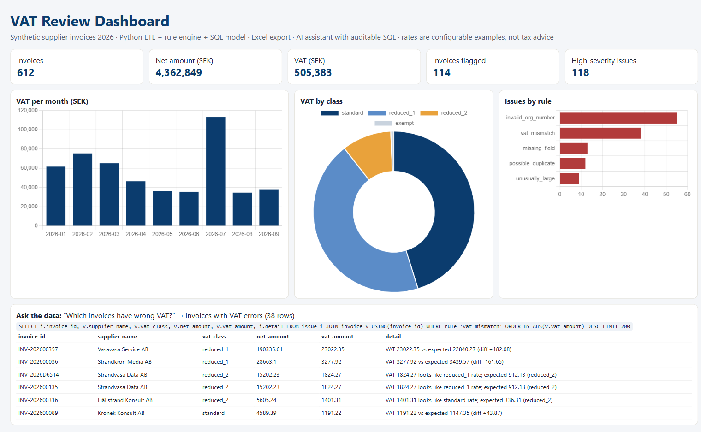

# Tax Invoice AI: VAT review pipeline, BI dashboard and data assistant

A small **tax-technology** tool that takes supplier invoices and turns them into a **reviewed, explainable VAT picture**:

1. **Python ETL + rule engine.** Validates every invoice:
   - VAT recalculated per VAT class, and the explanation points to the wrong rate when one was applied
   - net + VAT = total
   - required fields present
   - organisation-number Luhn check
   - possible duplicates
   - unusually large invoices per supplier (robust median/MAD)
2. **SQL data model** with a `vat_by_month` view and an `issue` table, so every finding is traceable to an invoice and a rule.
3. **Excel review workbook** (`output/vat_review.xlsx`) with Summary, Issues, VAT by month and Invoices sheets, for reviewers who live in Excel.
4. **BI dashboard** (Power BI-style views: KPI cards, VAT per month, VAT by class, issues by rule).
5. **AI data assistant.** Ask in plain language, e.g. *"Which invoices have wrong VAT?"* or *"Top suppliers by spend"*, and get the
   answer **together with the SQL that produced it**:
   - Offline mode uses vetted query templates. If `ANTHROPIC_API_KEY` is set, an LLM writes the SQL from the schema.
   - In both modes, guardrails allow only a single read-only `SELECT`, run it over a read-only connection and cap the
     number of rows, so generated queries can be audited and can't change data.



## Results on the synthetic dataset (612 invoices, 45 suppliers)
| Rule | Findings |
|---|---|
| invalid organisation number (Luhn) | 55 invoices (from 3 suppliers with invalid numbers) |
| VAT mismatch | 38: wrong rate applied (e.g. 12 % used on a 6 % item) or arithmetic errors |
| missing mandatory field | 13 |
| possible duplicate | 12: same supplier, date and amounts resubmitted under a new invoice number |
| unusually large | 9 |

**114 invoices flagged, 118 high-severity issues**, each with a human-readable explanation.

## Run
```bash
pip install -r requirements.txt
python -m taxai.generate     # synthetic invoices -> data/invoices.csv
python -m taxai.pipeline     # validate -> output/tax.db + output/vat_review.xlsx
python -m taxai.dashboard    # output/dashboard.html
python -m pytest -q          # rule tests, pipeline/Excel, agent answers and SQL guardrails
```
```python
from taxai.agent import ask
ask("Which invoices have wrong VAT?", "output/tax.db")   # -> rows + the SQL that produced them
```

## Notes
- All companies, numbers and invoices are **fictitious**.
- VAT rates (25 / 12 / 6 % / exempt) are **configurable examples** in `taxai/config.py`. Real rates change over time and
  must be verified with the tax authority. This is a portfolio project, not tax advice.

## Author
**Dr. Ameer Kadhim Hadi**, data, AI and cloud engineering · [GitHub](https://github.com/ameerkhadi) · MIT License
